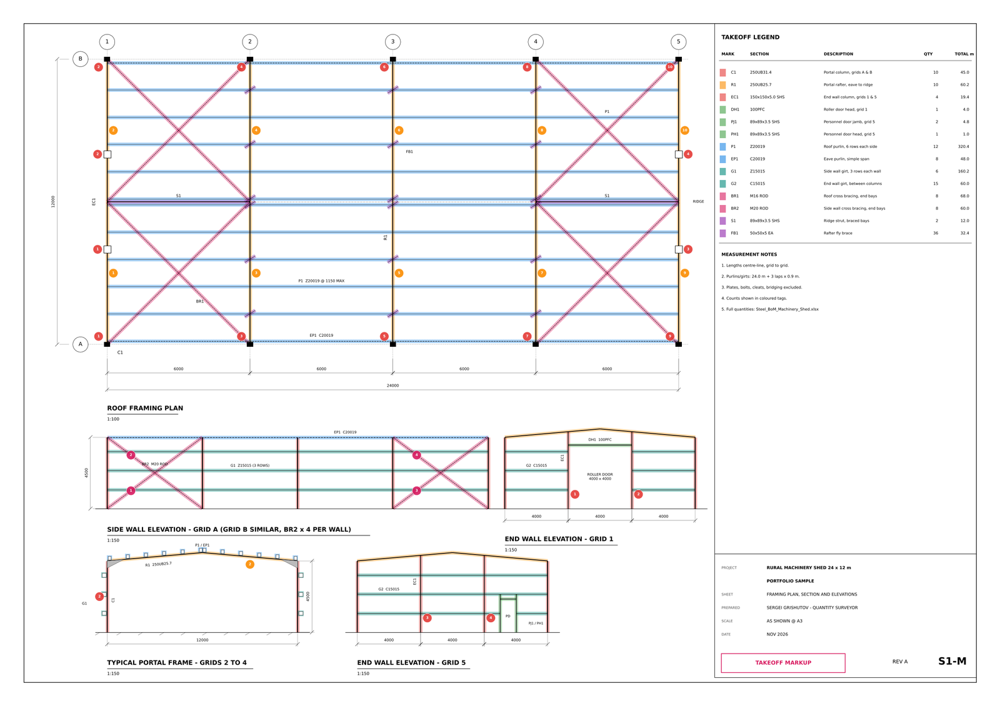
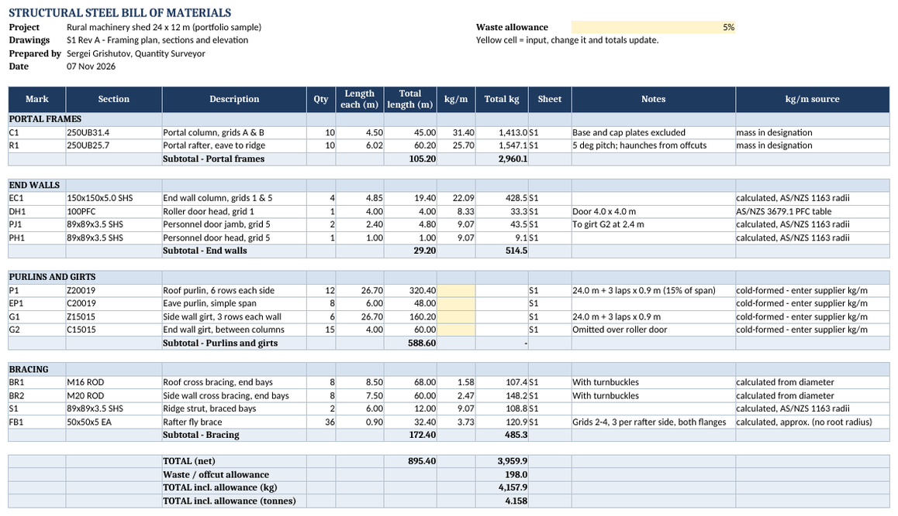
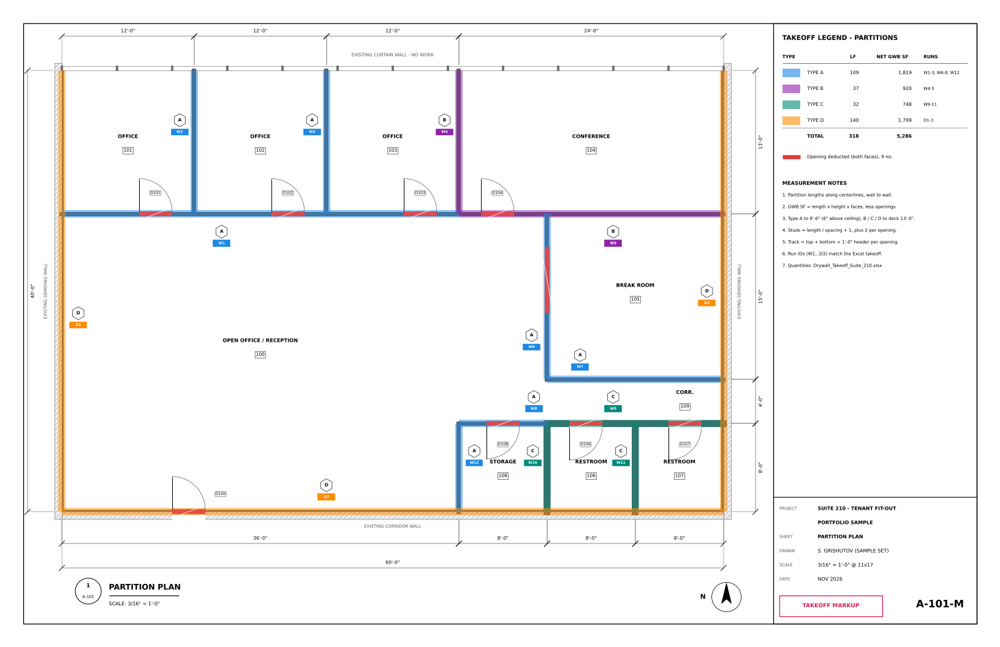
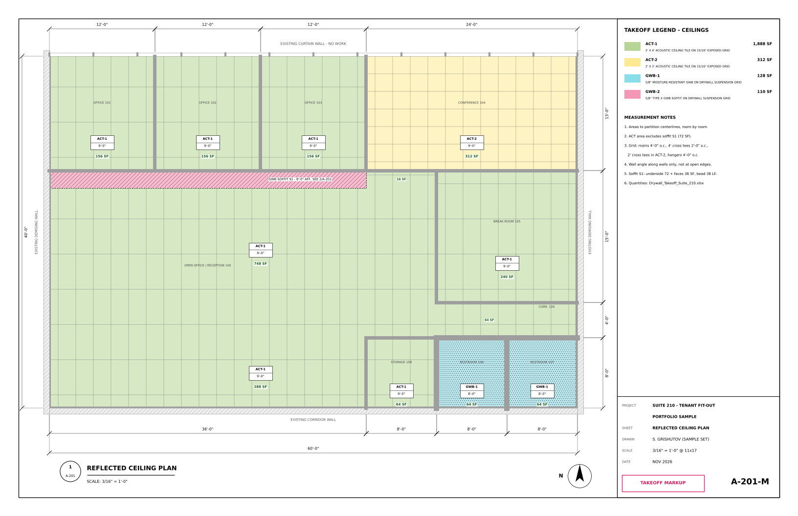
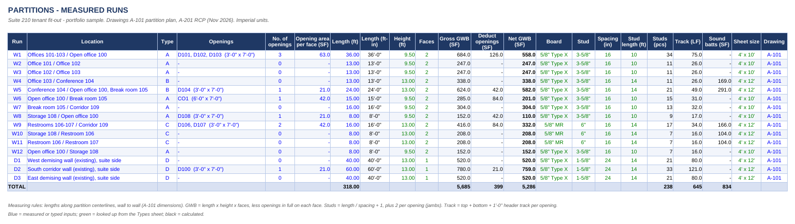
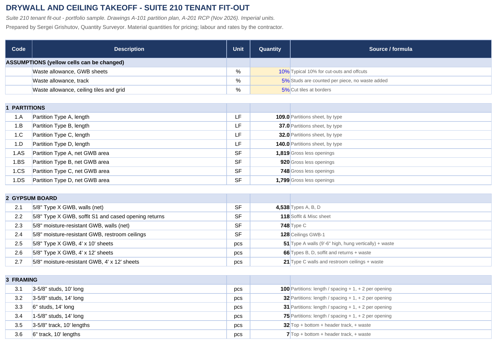
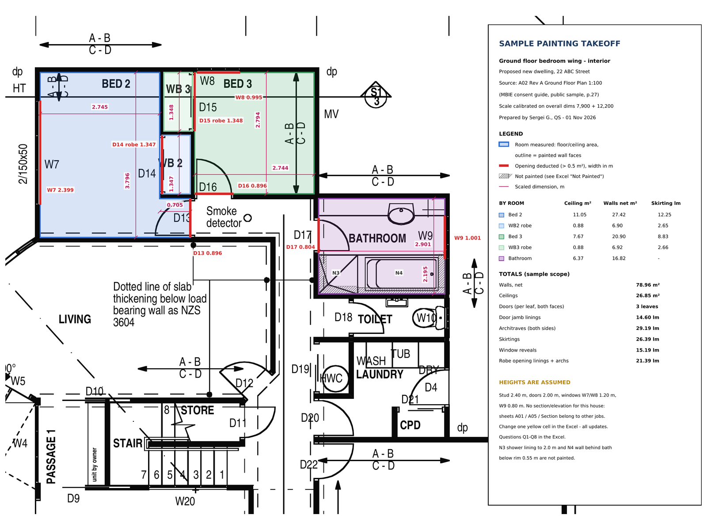
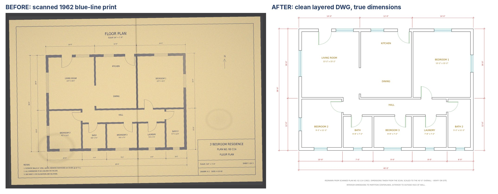
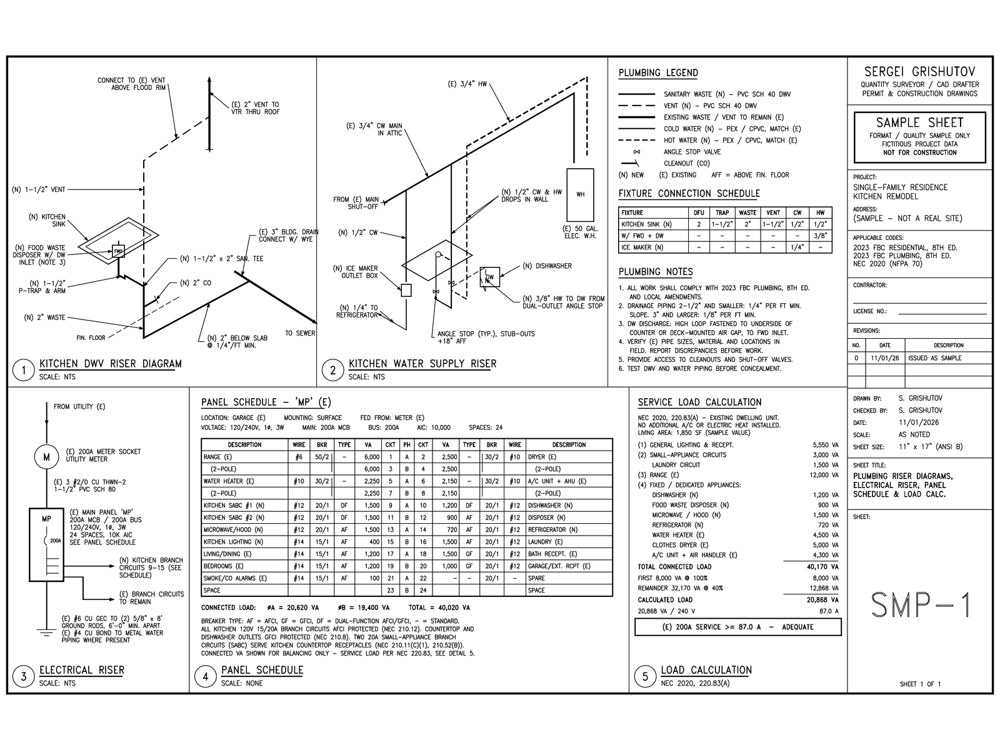

# Takeoff samples

Samples of my quantity takeoff and drafting work. Client work is under NDA, so these use public bid drawings or sample drawings I prepared. No client information.

| Sample | Type | Files |
| --- | --- | --- |
| [1. Structural steel takeoff, portal-frame shed](#1-structural-steel-takeoff---portal-frame-shed) | Steel member list, weights, markup | `steel-shed/` |
| [2. Drywall and ceiling takeoff, office fit-out](#2-drywall-and-ceiling-takeoff---office-fit-out-us-units) | Partitions, GWB, framing, ACT and grid, US units | `drywall-office/` |
| [3. Painting takeoff, residence bedroom wing](#3-painting-takeoff---residence-bedroom-wing) | Finishes takeoff, markup | `Painting_Takeoff_*` |
| [4. Scanned plan to a clean DWG](#4-scanned-plan-to-a-clean-dwg) | AutoCAD redraw: layers, blocks, dimensions | `scan-to-dwg/` |
| [5. US residential permit sheet](#5-us-residential-permit-sheet) | AutoCAD drafting | `SMP-1_*.pdf` |
| [6. Drywall and ceilings, public office fit-out (real bid set)](#6-drywall-and-ceilings---public-office-fit-out-madison-wi) | Partitions by type, GWB, framing, ACT, US units | `dane-county-ti/` |

## 1. Structural steel takeoff - portal-frame shed
A 24 x 12 m machinery shed (sample A3 framing sheet) measured the way steel fabricators ask for it: steel members only, plates, bolts and nuts excluded.

- `steel-shed/S1_Machinery_Shed_Framing.pdf`: the drawing
- `steel-shed/S1_Machinery_Shed_Takeoff_Markup.pdf`: every member colour-coded by type, count tags, legend with totals
- `steel-shed/Steel_BoM_Machinery_Shed.xlsx`: bill of materials by mark (qty, length, kg/m, kg), subtotals, 5 % allowance, summary by section, notes and exclusions

Built with my [steel-takeoff-tools](https://github.com/Grishutov/steel-takeoff-tools).

## 2. Drywall and ceiling takeoff - office fit-out, US units
A 2,400 SF office suite fit-out (sample set: A-101 partition plan and A-201 reflected ceiling plan, 11x17) measured the way drywall and ceiling contractors price it.

- `drywall-office/A-101_A-201_Suite_210_Fit-Out.pdf`: the drawings
- `drywall-office/Drywall_Takeoff_Markup.pdf`: every wall run colour-coded by partition type with its run ID, openings deducted, ceilings coloured by type with areas
- `drywall-office/Drywall_Takeoff_Suite_210.xlsx`:
  - **Partitions**: 15 runs with length, height, faces, openings, net GWB SF, studs, track and sound batts
  - **Ceilings**: room by room, with ACT tiles, main and cross tees, wall angle and hanger wires
  - **Soffit & Misc**: GWB soffit, returns and corner bead
  - **Summary**: board sheets, studs and track by size, insulation, ceiling materials, an area check against the overall dimensions
  - **Notes & Queries**: measuring rules, exclusions and four queries to the client

Totals: 318 LF of partitions, 5,286 SF of net GWB on walls, 2,200 SF of ACT and 128 SF of GWB ceilings. Every quantity is a live formula, so changing a height, a partition type or a waste factor updates the counts.

## 3. Painting takeoff - residence, bedroom wing
Source drawing: the public example floor plan from the New Zealand MBIE "Guide to applying for a building consent" (2007).

- `Painting_Takeoff_Bedroom_Wing.xlsx`: room-by-room takeoff of walls, ceilings, doors, trims and openings. Every line is referenced to the drawing; assumptions, items not painted and clarifications are on separate sheets.
- `Painting_Takeoff_Markup.pdf`: colour-coded markup of what was measured.

Measured to NZ painting practice: m² and lm, openings over 0.5 m² deducted. The public set has no sections, so wall heights are assumptions and are flagged in yellow.

## 4. Scanned plan to a clean DWG
An old-style blue-line house plan (sample drawing), scanned at an angle and slightly stretched, with a fold and stains. Redrawn as a clean AutoCAD drawing that someone else can work with.

- `scan-to-dwg/Original_Scan_Plan_62-114.jpg`: the scan
- `scan-to-dwg/A-101_As-Built_Floor_Plan.dwg` (AutoCAD 2018) and `.dxf`: the redraw
- `scan-to-dwg/A-101_As-Built_Floor_Plan.pdf`: the 11x17 sheet

The drawing has:
- model space at 1:1 in architectural units
- layers A-WALL, A-DOOR, A-GLAZ, A-ANNO-TEXT, A-ANNO-DIMS and A-ANNO-NOTE
- doors and windows as blocks, so they can be counted
- true dimensions, and room names with clear sizes

The scan was deskewed and scaled to the 40'-0" overall dimension, then checked against the 28'-0" one. The method is in my guide [PDF or image to a clean DWG](https://github.com/Grishutov/cad-guides/blob/main/pdf-to-dwg.md).

## 5. US residential permit sheet
- `SMP-1_Kitchen_Riser_Panel_Schedule.pdf`: 11x17 sheet plotted from AutoCAD with kitchen DWV and water supply riser isometrics, electrical riser, 24-space panel schedule and NEC 220.83(A) service load calculation. Sample project data, not for construction.

## 6. Drywall and ceilings - public office fit-out, Madison WI
A real public bid set: tenant improvements on the third floor of the City-County Building in Madison, Wisconsin (Dane County Public Works, RFB 108049, 2008; 26 sheets at 24x36). Measured the way a drywall and ceiling contractor prices it.

- `dane-county-ti/DaneCounty_TI_Drywall_Takeoff.xlsx`:
  - **Partitions**: 78 wall runs in 9 types from the enlarged plans A2.1-A2.3; doors from the A7.0 schedule deducted on every face and layer
  - **Ceilings**: room by room from the reflected ceiling plan A3.0 and the finish schedule A9.0, with ACT tiles, main and cross tees, wall angle and hanger wires
  - **Types**: partition types from A7.0 with layers, studs and batts; change one height and every run updates
  - **Summary**: board sheets, studs and track by size, batts, bead and finishing, ceilings, and the checks
  - **Notes & Queries**: measuring rules, exclusions and 15 queries to the client
- `dane-county-ti/DaneCounty_TI_Drywall_Markup.pdf`: colour markup on sheets A2.1-A2.3 and A3.0, every run with its ID and type

Totals: 686 LF of new partitions in 9 types, 12,284 SF of GWB net of openings, 8,215 SF of ACT, 21 doors deducted.

Checks: lengths taken from the PDF vector linework, not scaled by eye; scale checked on three sheets. Ceilings measured room by room and again as one outline (the 6.5 % difference is the wall footprint). Partition lengths checked against half the length of all wall face lines.

Drawings: Dane County Public Works, RFB 108049 (2008), public bid documents. Only the four measured sheets are included.
